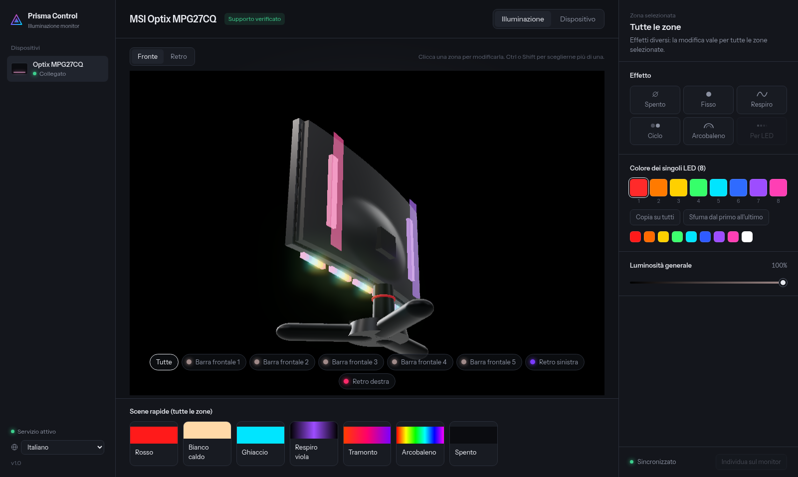

<div align="center">

# 🔺 Prisma Control

### Illuminazione RGB dei monitor MSI su Linux — dal browser

[English](README.md) · **Italiano**

[](LICENSE)
[](https://www.python.org/)
[](#requisiti)


[](#aiutare-a-supportare-altri-modelli)

Prisma riconosce il monitor collegato, ne mostra le zone LED e conserva le impostazioni
dopo riavvii, spegnimenti del monitor e ricollegamenti del cavo.



</div>

## Indice

[Funzioni](#funzioni) · [Monitor supportati](#monitor-supportati) · [Requisiti](#requisiti) · [Installazione](#installazione) · [Riga di comando](#riga-di-comando) · [Come funziona](#come-funziona) · [Vista 3D](#vista-3d) · [Disposizione multi-monitor](#disposizione-multi-monitor) · [Lingue](#lingue) · [Problemi noti](#problemi-noti) · [Contribuire](#aiutare-a-supportare-altri-modelli) · [Licenza](#crediti-e-licenza)

## Funzioni

- **Monitor 3D interattivo** (WebGL): si ruota trascinando, materiali PBR, un vero pavimento riflettente,
  luce da studio con ombre morbide, bloom sui LED e bagliore dal vivo; alla selezione di un dispositivo
  parte una rotazione completa. Ripiega su una vista 2D dove WebGL (o un effetto opzionale) non è disponibile
- **Disposizione multi-monitor**: trascina i tuoi monitor nella loro posizione reale sulla scrivania
  dalla barra laterale ("Disponi i monitor"); l'ordine da sinistra a destra guida la barra laterale
  e gli strumenti che coinvolgono più monitor
- **Rilevamento automatico** dei monitor MSI collegati e della disposizione dei loro LED
- **Effetti**: fisso, respiro, ciclo di colori, arcobaleno e gli effetti nativi Mystic Light
  (lampeggio, flash, tende, meteora, casuale)
- **Colore per singolo LED** sulle zone che lo permettono, con sfumatura e copia rapida
- **Più monitor** insieme, ognuno con le sue impostazioni
- **Impostazioni persistenti**: vengono riapplicate all'avvio e ogni volta che il monitor ricompare
  sulla USB, e salvate nella memoria del monitor quando il modello lo consente
- **15 lingue**, scelte da un menu a tendina (rilevate in automatico dal browser), incluso l'arabo da destra a sinistra
- **Nessuna dipendenza**: solo la libreria standard di Python 3, funziona anche senza internet
  su `http://127.0.0.1:7878`

## Monitor supportati

| Modello | Controller LED | Stato |
|---|---|---|
| Optix MPG27CQ | SteelSeries | ✅ provato |
| Optix MPG341CQR | SteelSeries | 🧪 sperimentale, zone sconosciute |
| MAG321CURV, MAG321CQR, MAG241CR, MAG271CR, MAG271CQR, MAG272CQR, MAG272QP, MAG251RX | Mystic Light | 🧪 sperimentale |
| MPG273CQR, MAG274R, MAG274QRF-QD, MAG274QRX | Mystic Light (Optix) | 🧪 sperimentale |

*Sperimentale* vuol dire che il protocollo è documentato da msigd, ma Prisma non è ancora stato
verificato su quel modello. Se ne hai uno, una segnalazione con l'esito è molto utile.

## Requisiti

- Linux con systemd
- Python 3.8 o successivo
- Il **cavo USB** del monitor (presa USB‑B sul retro) collegato al computer. I LED si comandano
  dalla USB, non dal cavo video. Una volta impostati, i colori restano salvati nel monitor:
  il cavo serve solo per cambiarli.

## Installazione

```sh
git clone https://github.com/<utente>/prisma-monitor-led.git
cd prisma-monitor-led
./install.sh
```

Lo script chiede la password di sudo solo per aggiungere una regola udev, che permette di usare i
controller del monitor senza root. Poi avvia il servizio utente `monitor-led` e aggiunge
**Prisma Control** al menu applicazioni. La dashboard si apre da lì o su `http://127.0.0.1:7878`.

## Riga di comando

Dalla cartella `~/.local/share/monitor-led`:

```sh
python3 -m msiled --detect          # monitor rilevati, zone e numero di LED
python3 -m msiled --list-models     # modelli conosciuti
python3 -m msiled --color ff0000    # colore fisso sul primo monitor
```

## Disinstallazione

```sh
./uninstall.sh            # mantiene le impostazioni salvate
./uninstall.sh --purge    # cancella anche le impostazioni
```

I LED restano con l'ultimo colore salvato nel monitor.

## Come funziona

Molti monitor MSI contengono un hub USB con uno o due controller:

- **MSI Gaming Controller** (`1462:3fa4`): comunica il modello e comanda i LED dei monitor Mystic Light
- **SteelSeries MLC** (`1038:1126`): comanda i LED di alcuni modelli MPG

Un piccolo servizio Python parla con loro tramite `/dev/hidraw`. Ogni due secondi controlla quali monitor
sono collegati e riconosce il modello, dal controller MSI oppure, in mancanza, dal nome trasmesso via
HDMI/DisplayPort (EDID). Le impostazioni stanno in `~/.config/monitor-led/state.json`.

## Vista 3D

Il monitor è una scena WebGL in tempo reale (Three.js incluso in `dashboard/vendor/`, servito in locale,
senza CDN). Si ruota trascinando, si zooma con la rotellina; alla selezione di un dispositivo parte una
rotazione completa. Le strisce LED sono dal vivo e seguono le tue impostazioni. Una luce da studio (key,
fill, controluce) proietta ombre morbide reali, il bloom fa risplendere i LED e il pavimento è un vero
riflesso della scena dove supportato. Bloom e riflesso del pavimento sono extra caricati a runtime: se
non si caricano, la vista 3D funziona comunque, solo senza quei due effetti.

Per un render fotorealistico offline c'è uno script Blender opzionale in
[`blender/`](blender/README.md) che produce un fermo immagine e una rotazione con Cycles. È uno strumento
a sé (serve Blender installato) e non è necessario per usare la dashboard.

## Disposizione multi-monitor

Se viene rilevato più di un monitor supportato, accanto a "Dispositivi" nella barra laterale compare
una piccola icona a griglia. Apre un pannello dove trascini ogni monitor nella sua posizione reale sulla
scrivania, con i bordi che si agganciano come nelle impostazioni schermo del sistema operativo. L'ordine
da sinistra a destra che imposti lì guida l'ordine dell'elenco dei dispositivi ed è pensato per gli
strumenti che ragionano su più monitor insieme. La disposizione viene salvata dal servizio
(`~/.config/monitor-led/state.json`) e ripristinata al prossimo avvio.

## Lingue

La dashboard è tradotta in 15 lingue, scelte dal menu a tendina nella barra laterale. Al primo avvio
la lingua viene scelta in base al browser e poi ricordata:

English · Italiano · Español · Français · Deutsch · Português · Русский · 中文 · 日本語 · 한국어 ·
Nederlands · Polski · Türkçe · Українська · العربية (da destra a sinistra).

Le traduzioni sono un punto di partenza: correzioni e nuove lingue sono benvenute. Ogni testo sta sotto
una breve chiave in [`dashboard/i18n.js`](dashboard/i18n.js); copia il blocco `en`, traduci i valori e
aggiungi una voce in `LANGS`.

## Problemi noti

- Sull'MPG27CQ gli effetti animati (respiro, ciclo, arcobaleno) possono fermarsi dopo il salvataggio
  nella memoria del monitor. I colori fissi e per singolo LED non ne risentono. La correzione è in corso.

## Aiutare a supportare altri modelli

- **Modello riconosciuto ma LED sbagliati o mancanti** (controller SteelSeries): lancia `python3 diag.py`
  da `~/.local/share/monitor-led` guardando il monitor, e segnala cosa si accende a ogni passo.
- **Modello non riconosciuto**: apri una segnalazione con l'output di `python3 -m msiled --detect`
  e il nome esatto del modello.

## Avvertenze

Prisma Control è un progetto indipendente e non ufficiale: non è affiliato, approvato né supportato
da MSI o SteelSeries. I nomi dei modelli servono solo a indicare la compatibilità. I protocolli sono
stati ricavati per ingegneria inversa: l'uso è a tuo rischio. Il menu del monitor (OSD) non viene mai modificato.

## Crediti e licenza

I protocolli dei controller e la tabella dei modelli derivano da [msigd](https://github.com/couriersud/msigd)
di couriersud e collaboratori, con licenza GPL‑2.0. Prisma Control è distribuito con licenza
**GNU General Public License v2.0**, vedi [LICENSE](LICENSE).

I componenti di terze parti inclusi mantengono la loro licenza: [Three.js](https://threejs.org) (MIT, in
`dashboard/vendor/`) e il font Instrument Sans (SIL Open Font License, in `dashboard/fonts/OFL.txt`).

---

<div align="center">

Se Prisma Control ti è utile, lascia una ⭐ — aiuta altri a trovarlo.

`linux` · `rgb` · `led` · `msi` · `mystic-light` · `steelseries` · `monitor` · `hidraw` · `python` · `openrgb-alternative`

</div>
