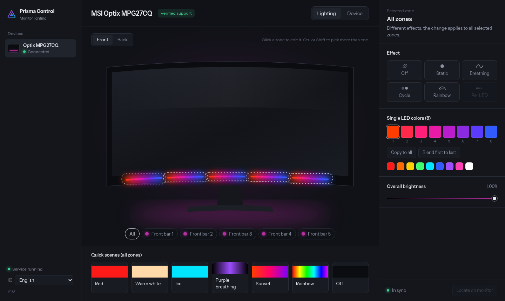

<div align="center">

# 🔺 Prisma Control

### RGB lighting for MSI monitors on Linux — in your browser

**English** · [Italiano](README.it.md)

[](LICENSE)
[](https://www.python.org/)
[](#requirements)


[](#help-support-more-models)

Prisma detects the connected monitor, shows its LED zones and keeps your settings
across reboots, monitor power cycles and cable reconnections.



</div>

## Contents

[Features](#features) · [Supported monitors](#supported-monitors) · [Requirements](#requirements) · [Installation](#installation) · [Command line](#command-line) · [How it works](#how-it-works) · [Languages](#languages) · [Known issues](#known-issues) · [Contributing](#help-support-more-models) · [License](#credits-and-license)

## Features

- **Automatic detection** of connected MSI monitors and their LED layout
- **Effects**: static, breathing, color cycle, rainbow, and the native Mystic Light effects
  (blinking, flash, blinds, meteor, random)
- **Per-LED colors** on supported zones, with gradient and fill tools
- **Multiple monitors** at once, each with its own settings
- **Persistent**: settings are reapplied at boot and whenever the monitor reappears on USB,
  and saved into the monitor's memory where supported
- **15 languages**, chosen from a dropdown (auto-detected from the browser), including right-to-left Arabic
- **No dependencies**: pure Python 3 standard library, works offline on `http://127.0.0.1:7878`

## Supported monitors

| Model | LED controller | Status |
|---|---|---|
| Optix MPG27CQ | SteelSeries | ✅ tested |
| Optix MPG341CQR | SteelSeries | 🧪 experimental, zone layout unknown |
| MAG321CURV, MAG321CQR, MAG241CR, MAG271CR, MAG271CQR, MAG272CQR, MAG272QP, MAG251RX | Mystic Light | 🧪 experimental |
| MPG273CQR, MAG274R, MAG274QRF-QD, MAG274QRX | Mystic Light (Optix) | 🧪 experimental |

*Experimental* means the protocol is documented by msigd but Prisma has not yet been confirmed
on that model. If you own one, please report whether it works.

## Requirements

- Linux with systemd
- Python 3.8 or newer
- The monitor's **USB upstream cable** (USB‑B port on the back) connected to the computer.
  The LEDs are controlled over USB, not over the video cable. Once set, colors are stored
  in the monitor, so the cable is only needed to change them.

## Installation

```sh
git clone https://github.com/<user>/prisma-monitor-led.git
cd prisma-monitor-led
./install.sh
```

The installer asks for sudo only to add a udev rule, so the monitor's controllers can be used
without root. It then starts the `monitor-led` user service and adds **Prisma Control** to the
application menu. Open the dashboard from there or at `http://127.0.0.1:7878`.

## Command line

Run from `~/.local/share/monitor-led`:

```sh
python3 -m msiled --detect          # show detected monitors, zones and LED counts
python3 -m msiled --list-models     # list known models
python3 -m msiled --color ff0000    # set a static color on the first monitor
```

## Uninstall

```sh
./uninstall.sh            # keeps your saved settings
./uninstall.sh --purge    # removes the settings too
```

The LEDs keep the last color saved in the monitor.

## How it works

Many MSI monitors contain a USB hub with one or two controllers:

- **MSI Gaming Controller** (`1462:3fa4`): reports the model ID and drives the LEDs on Mystic Light monitors
- **SteelSeries MLC** (`1038:1126`): drives the LEDs on some MPG models

A small Python service talks to them through `/dev/hidraw`. Every two seconds it checks which monitors
are connected and identifies each model, from the MSI controller or, as a fallback, from the name sent
over HDMI/DisplayPort (EDID). Settings are stored in `~/.config/monitor-led/state.json`.

## Languages

The dashboard ships in 15 languages, picked from the dropdown in the sidebar. On first launch the
language is chosen from the browser and remembered afterwards:

English · Italiano · Español · Français · Deutsch · Português · Русский · 中文 · 日本語 · 한국어 ·
Nederlands · Polski · Türkçe · Українська · العربية (right-to-left).

The translations are a starting point — corrections and new languages are very welcome. Each string
lives under a short key in [`dashboard/i18n.js`](dashboard/i18n.js); copy the `en` block, translate the
values and add an entry to `LANGS`.

## Known issues

- On the MPG27CQ, animated effects (breathing, cycle, rainbow) may stop after being saved into the
  monitor's memory. Static and per-LED colors are not affected. A fix is being investigated.

## Help support more models

- **Model detected but LEDs wrong or missing** (SteelSeries controller): run `python3 diag.py` from
  `~/.local/share/monitor-led` while watching the monitor, and report what lights up at each step.
- **Model not detected**: open an issue with the output of `python3 -m msiled --detect` and the exact model name.

## Disclaimer

Prisma Control is an independent, unofficial project. It is not affiliated with, endorsed or supported
by MSI or SteelSeries. Model names are used only to describe compatibility. The protocols were
reverse-engineered: use at your own risk. The monitor's on-screen menu (OSD) is never modified.

## Credits and license

The controller protocols and the model table are based on [msigd](https://github.com/couriersud/msigd)
by couriersud and contributors, licensed under GPL‑2.0. Prisma Control is released under the
**GNU General Public License v2.0**, see [LICENSE](LICENSE).

Interface font: Instrument Sans, SIL Open Font License (see `dashboard/fonts/OFL.txt`).

---

<div align="center">

If Prisma Control is useful to you, consider leaving a ⭐ — it helps others find it.

`linux` · `rgb` · `led` · `msi` · `mystic-light` · `steelseries` · `monitor` · `hidraw` · `python` · `openrgb-alternative`

</div>
